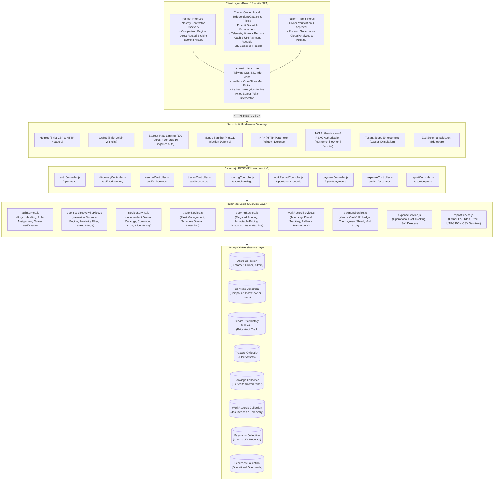
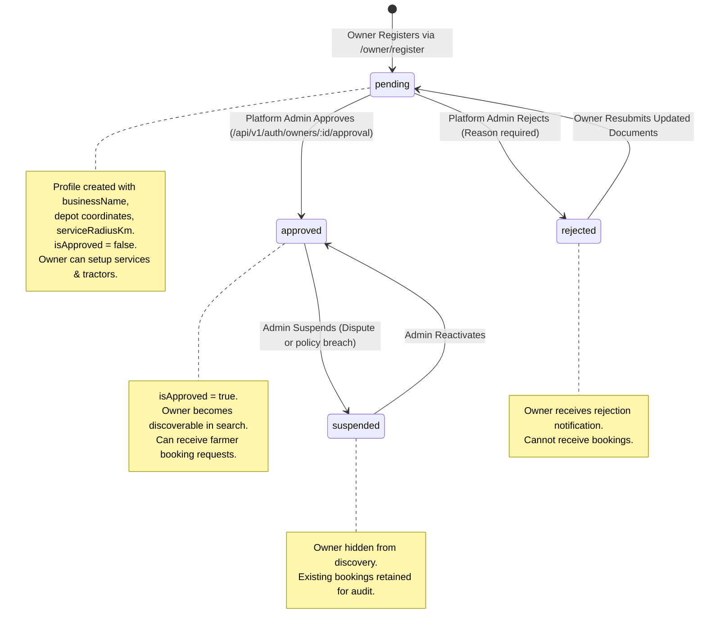
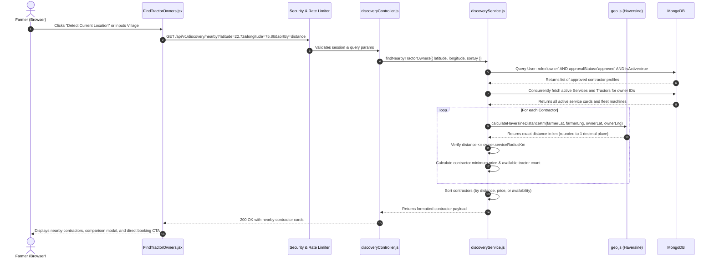
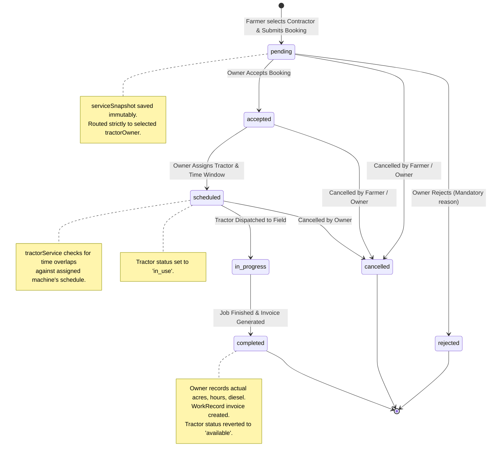
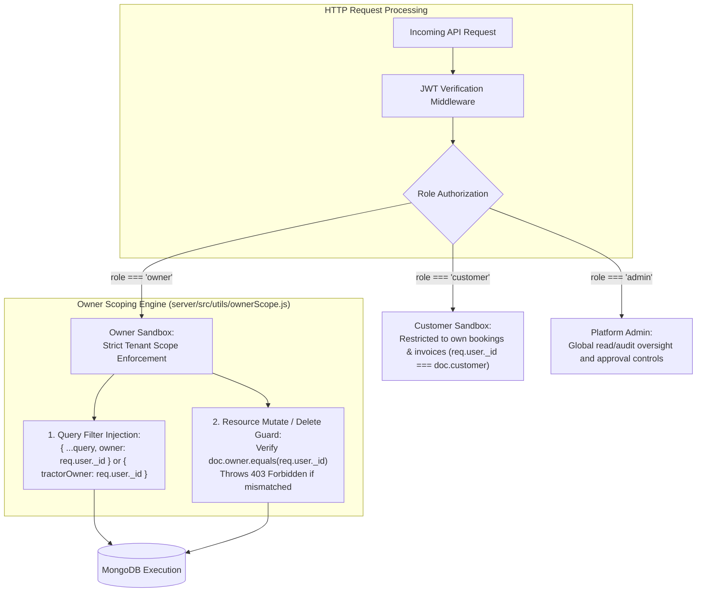

# TractorConnect Multi-Owner System Architecture & Technical Specifications

This document provides a comprehensive technical overview of **TractorConnect**, a production-grade multi-tractor-owner marketplace platform built on the MERN stack (Node.js, Express, MongoDB/Mongoose, React 18, Vite, Tailwind CSS). It details the system architecture, domain models, geospatial discovery engine, state machines, multi-tenant data isolation, and security controls.

---

## 1. High-Level System Architecture

TractorConnect is architected as a modular, decoupled full-stack platform serving three primary user roles:
1. **Farmers (Customers):** Discover nearby tractor contractors, compare prices and availability, route bookings to chosen contractors, track job progress, and view invoices.
2. **Tractor Owners (Contractors):** Manage independent service catalogs, custom pricing units, machinery fleets, schedule assignments, log field telemetry, record manual Cash/UPI payments, and analyze operational expenses and earnings.
3. **Platform Administrators:** Monitor platform-wide metrics, audit bookings, and govern tractor owner onboarding through a verification and approval workflow.



---

## 2. Entity-Relationship (ER) Domain Model

The schema uses normalized references (`ObjectId` refs) alongside strategic snapshot embedding to preserve historical billing integrity. In the multi-owner model, all operational resources (`Service`, `Tractor`, `Booking`, `WorkRecord`, `Payment`, `Expense`) carry an indexed owner reference (`owner` or `tractorOwner`).

```mermaid
erDiagram
    User ||--o{ Service : "owns & manages catalog"
    User ||--o{ Tractor : "owns machinery fleet"
    User ||--o{ Booking : "customer books OR owner receives"
    User ||--o{ WorkRecord : "associated contractor"
    User ||--o{ Payment : "received by owner / paid by customer"
    User ||--o{ Expense : "incurred by owner"
    User ||--o{ ServicePriceHistory : "records rate change"

    Service ||--o{ ServicePriceHistory : "maintains historical rates"
    Service ||--o{ Booking : "original service definition"

    Tractor ||--o{ Booking : "assigned to field job"
    Tractor ||--o{ Expense : "asset maintenance allocation"

    Booking ||--|| WorkRecord : "generates invoice upon completion (1:1)"
    WorkRecord ||--o{ Payment : "settled via manual payments (1:N)"

    User {
        ObjectId _id PK
        string name "User legal name"
        string mobile UK "10-digit Indian format (^[6-9]\\d{9}$)"
        string email "Optional contact"
        string passwordHash "Bcrypt cost >= 10"
        enum role "customer | owner | admin | operator"
        string businessName "Owner business trade name"
        number serviceRadiusKm "Operating radius (default: 25 km)"
        object location "latitude, longitude, village, district, state, fullAddress"
        string serviceDescription "Owner capabilities & equipment description"
        boolean isApproved "Platform approval flag"
        enum approvalStatus "pending | approved | rejected | suspended"
        Date approvedAt "Timestamp of platform approval"
        ObjectId approvedBy FK "Admin reference"
        string rejectionReason "Required explanation if rejected"
        string village "Farmer village"
        string district "Farmer district"
        string state "Default: Madhya Pradesh"
        boolean isActive "Default: true"
        Date createdAt
        Date updatedAt
    }

    Service {
        ObjectId _id PK
        ObjectId owner FK "Tractor owner reference (null for legacy)"
        string name "Service title (e.g., Deep Disc Ploughing)"
        string slug "URL slug with owner hash suffix"
        string category "Land Preparation | Sowing | Harvesting | Haulage"
        string description "Operational scope"
        enum pricingUnit "per_acre | per_hour | per_trip | per_day"
        number currentPrice "Rate in INR"
        number minimumCharge "Base callout fee in INR"
        boolean isActive "Default: true (Soft hide)"
        number displayOrder
        Date createdAt
        Date updatedAt
    }

    ServicePriceHistory {
        ObjectId _id PK
        ObjectId service FK
        ObjectId owner FK
        number price "Historical rate"
        enum pricingUnit "per_acre | per_hour | per_trip | per_day"
        Date effectiveFrom "Audit timestamp"
        ObjectId changedBy FK
        string note "Reason for tariff adjustment"
    }

    Tractor {
        ObjectId _id PK
        ObjectId owner FK "Tractor owner reference"
        string name "Asset label (e.g., Mahindra 575 DI)"
        string registrationNumber UK "State RTO registration"
        string model "Model year or designation"
        number horsepower "Engine output (e.g., 50 HP)"
        enum status "available | in_use | maintenance | inactive"
        string currentOperatorName
        boolean isActive "Default: true"
    }

    Booking {
        ObjectId _id PK
        ObjectId customer FK "Farmer reference"
        ObjectId tractorOwner FK "Assigned contractor reference"
        ObjectId service FK "Service reference"
        object serviceSnapshot "name, pricingUnit, unitPrice, minimumCharge (Immutable)"
        number estimatedQuantity "Acreage or estimated hours"
        number estimatedCost "Calculated forecast in INR"
        Date requestedDate "Target service date"
        string requestedTimeSlot "Morning | Afternoon | Evening"
        object fieldLocation "latitude, longitude, village, tehsil, district, state, pincode, fullAddress, landmark"
        string cropType "e.g., Wheat, Soybean, Gram"
        string customerNotes
        enum status "pending | accepted | scheduled | in_progress | completed | rejected | cancelled"
        string rejectionReason
        string cancellationReason
        enum cancelledBy "customer | owner | admin"
        Date scheduledStart "Conflict check boundary"
        Date scheduledEnd "Conflict check boundary"
        ObjectId assignedTractor FK
        string assignedOperatorName
        array statusHistory "status, changedBy, changedAt, note"
        Date createdAt
    }

    WorkRecord {
        ObjectId _id PK
        ObjectId booking FK UK "1:1 mapping"
        ObjectId customer FK
        ObjectId tractorOwner FK "Contractor reference"
        ObjectId service FK
        object serviceSnapshot "Immutable billing rates"
        ObjectId tractor FK "Dispatched machine"
        string operatorName
        object fieldLocation "Field GPS & village details"
        number actualQuantity "Billed acres or hours"
        number actualAcres "Worked area"
        number actualHours "Engine run hours"
        number dieselConsumedLiters "Fuel consumed"
        number baseCharge "actualQuantity * snapshotPrice"
        number discount "Contractor courtesy reduction"
        number extraCharges "Transport or terrain surcharge"
        string extraChargesReason
        number totalAmount "finalCharge = baseCharge - discount + extra"
        number amountPaid "Sum of non-voided receipts"
        number balanceDue "totalAmount - amountPaid"
        enum paymentStatus "unpaid | partially_paid | paid"
        Date completedAt
    }

    Payment {
        ObjectId _id PK
        ObjectId workRecord FK "Invoice reference"
        ObjectId booking FK
        ObjectId customer FK "Payer"
        ObjectId tractorOwner FK "Payee contractor"
        number amount "Collected amount in INR"
        enum method "cash | upi | bank_transfer | other"
        string referenceNumber "UPI transaction ref or physical receipt no"
        Date paymentDate
        ObjectId receivedBy FK "Collector"
        boolean isVoided "Soft-delete audit flag"
        string voidReason "Mandatory justification"
        ObjectId voidedBy FK
        Date voidedAt
    }

    Expense {
        ObjectId _id PK
        ObjectId tractorOwner FK "Incurring contractor"
        ObjectId tractor FK "Optional machinery allocation"
        enum category "diesel | maintenance | repair | spare_parts | labour | insurance | other"
        number amount "Expense value in INR"
        Date date
        string description
        string billNumber
        string paidTo "Fuel bunk or workshop vendor"
        ObjectId recordedBy FK
        boolean isDeleted "Soft delete flag"
    }
```

---

## 3. Tractor Owner Approval & Onboarding State Machine

To protect farmers from fraudulent or unverified machinery providers, all newly registered tractor owners enter an onboarding gate. Only approved owners are surfaced in geospatial search and permitted to receive bookings.



---

## 4. Nearby Contractor Discovery & Geocoding Flow

When a farmer navigates to **Find Tractor Owners** (`/customer/find-tractors`), the frontend acquires the farmer's GPS coordinates (via browser `navigator.geolocation` or manual village/district selection). The discovery pipeline executes distance calculations and catalog aggregation without requiring third-party paid map APIs:



---

## 5. Booking Lifecycle & Multi-Owner Dispatch State Machine

Bookings are targeted to a specific tractor owner. The owner manages the booking through a sequential state machine. Machine conflicts are prevented across the owner's fleet.



### Booking Transition Validation Matrix

| Current State | Target State | Permitted Actor | Payload & Side-Effect Validation |
| :--- | :--- | :--- | :--- |
| `pending` | `accepted` | `owner`, `admin` | Appends transition record to `statusHistory`. |
| `pending` | `rejected` | `owner`, `admin` | Requires non-empty `rejectionReason`. |
| `pending` | `cancelled`| `customer`, `owner`, `admin` | Requires `cancellationReason`. |
| `accepted` | `scheduled`| `owner`, `admin` | Requires `assignedTractor`, `scheduledStart`, `scheduledEnd`. Executes overlap query across owner's fleet. |
| `scheduled` | `in_progress`| `owner`, `admin` | Automatically updates `Tractor.status` to `in_use`. |
| `in_progress`| `completed`| `owner`, `admin` | Requires `actualQuantity`, `actualAcres`, `actualHours`, `dieselConsumedLiters`. Creates `WorkRecord`, frees `Tractor.status` to `available`. |

---

## 6. Multi-Tenant Data Isolation & Security Architecture

TractorConnect enforces a **logical multi-tenancy model** where each tractor owner operates inside an isolated sandbox. One tractor owner can never view, mutate, or intercept another owner's machinery, financial records, or customer bookings.



### Data Isolation Rules

1. **Service Isolation:** When an owner queries `/api/v1/services`, the backend injects `{ owner: req.user._id }`. Creating or editing a service verifies ownership before write.
2. **Machinery Isolation:** A contractor cannot assign a tractor belonging to another owner to their booking. The overlap detection query scopes by tractor ID and owner ID.
3. **Booking Isolation:** Route `/api/v1/bookings` automatically attaches `{ tractorOwner: req.user._id }` for owners. Attempting to accept, schedule, or view a booking belonging to another owner returns `403 Forbidden`.
4. **Financial Isolation:** Invoices (`WorkRecord`), Cash/UPI payments (`Payment`), and operational overheads (`Expense`) are strictly scoped to `tractorOwner: req.user._id`. Profit & Loss reports compute aggregates solely over the requesting owner's entries.

---

## 7. Key Technical Decisions & Architectural Patterns

### 7.1. Haversine Great-Circle Distance Engine
*Problem:* In rural agricultural regions, address geocoding APIs are costly, rate-limited, and often inaccurate for village farmland coordinates.
*Solution:* The discovery engine (`server/src/utils/geo.js`) calculates the spherical distance using the Haversine formula based on Earth's mean radius ($R = 6371 \text{ km}$):
$$\Delta\text{lat} = \text{lat}_2 - \text{lat}_1, \quad \Delta\text{lon} = \text{lon}_2 - \text{lon}_1$$
$$a = \sin^2\left(\frac{\Delta\text{lat}}{2}\right) + \cos(\text{lat}_1)\cos(\text{lat}_2)\sin^2\left(\frac{\Delta\text{lon}}{2}\right)$$
$$c = 2 \cdot \text{atan2}\left(\sqrt{a}, \sqrt{1-a}\right), \quad d = R \cdot c$$
Calculations are executed in sub-millisecond memory loops, enabling real-time sorting and radius filtering without third-party API dependencies.

---

### 7.2. Compound Service Catalogs & Suffix Slugs
*Problem:* In a multi-owner marketplace, multiple tractor owners provide services with identical names (e.g., "Deep Ploughing", "Rotavator"). A global unique index on service name would prevent other contractors from listing that service.
*Solution:*
1. **Compound Index:** The `Service` model enforces unique compound indexes on `{ owner: 1, name: 1 }` and `{ owner: 1, slug: 1 }`.
2. **Slug Suffix:** The Mongoose pre-save hook attaches a 4-character owner hash suffix (e.g. `deep-ploughing-6be3`), eliminating URL routing collisions while maintaining human-readable URLs.

---

### 7.3. Immutable Service Pricing Snapshot Architecture
*Problem:* Seasonal diesel inflation causes contractors to adjust tariffs frequently. If past bookings or work records resolved rates dynamically from `Service.currentPrice`, historical revenue, unbilled bookings, and finalized invoices would be retroactively corrupted.
*Solution:*
1. When a booking is created, the active pricing parameters are serialized into `booking.serviceSnapshot`:
   ```javascript
   serviceSnapshot: {
     name: service.name,
     pricingUnit: service.pricingUnit,
     unitPrice: service.currentPrice,
     minimumCharge: service.minimumCharge || 0
   }
   ```
2. When the job is completed, `workRecordService` computes charges using `booking.serviceSnapshot.unitPrice`.
3. Tariff adjustments automatically record an entry in `ServicePriceHistory` for audit compliance.

---

### 7.4. Offline Cash & UPI Tracking (Overpayment Shield & Void Audit)
*Problem:* Due to rural connectivity constraints and cash-dominated trade, tractor services are paid directly to operators in cash or via UPI transfers. Online payment gateways (Razorpay, Stripe) are strictly avoided.
*Integrity Controls:*
1. **Balance Check:** Before recording a payment, the API computes `pendingBalance = workRecord.totalAmount - workRecord.amountPaid`. If `amount > pendingBalance`, the request is rejected with `400 Bad Request` ("Payment amount exceeds pending balance").
2. **Atomic Recalculation:** Every payment automatically updates `WorkRecord.amountPaid` and adjusts `paymentStatus` (`unpaid` -> `partially_paid` -> `paid`).
3. **Immutable Void Audit:** Payments cannot be hard-deleted. Voiding a payment marks `isVoided: true`, requires a written `voidReason`, captures `voidedBy`, and rolls back `WorkRecord.amountPaid`.

---

### 7.5. Excel UTF-8 BOM & CSV Formula Injection Sanitization
*Problem:* Agricultural reports exported to CSV can be exploited via CSV Formula Injection (CWE-1236) if farmer names, addresses, or remarks start with formula characters (`=`, `+`, `-`, `@`). Furthermore, Hindi/Devanagari text appears corrupted in Microsoft Excel without an explicit byte order mark.
*Solution (`server/src/utils/csvExport.js`):*
1. **Byte Order Mark (BOM):** Every CSV download streams the UTF-8 BOM prefix `\uFEFF`.
2. **Formula Neutralization:** Every string cell is passed through `sanitizeCSVCell`:
   ```javascript
   function sanitizeCSVCell(value) {
     if (typeof value === 'string' && /^[=+\-@\t\r]/.test(value)) {
       return `'${value}`; // Prepend single quote to neutralize Excel execution
     }
     return value;
   }
   ```

---

### 7.6. Database Topology & Multi-Document Transaction Resilience
*Problem:* MongoDB multi-document transactions require a Replica Set. Attempting transactions on standalone local MongoDB instances (common on developer workstations) causes runtime failures.
*Solution (`server/src/services/workRecordService.js`):*
The persistence layer checks the runtime database topology:
- **Atlas / Replica Set Environments:** Wraps completion workflows in ACID multi-document transactions with automated abort.
- **Standalone Development Instances:** Executes sequential atomic database writes with programmatic compensation rollbacks if a downstream step fails.

---

## 8. Verification & Test Matrix

The system has been verified through comprehensive automated test suites covering backend services, multi-tenant isolation, geospatial discovery, and frontend React components.

| Layer | Test Suite | Tests | Status | Key Capabilities Verified |
| :--- | :--- | :---: | :---: | :--- |
| **Backend** | `multiOwner.test.js` | 18 | Passed | Owner registration, admin approval, geospatial discovery, direct booking routing, fleet schedule conflict detection, cross-owner 403 isolation. |
| **Backend** | `auth.test.js` | 14 | Passed | JWT issuance, Indian mobile normalization (`^[6-9]\d{9}$`), bcrypt hashing, role enforcement, profile updates. |
| **Backend** | `foundation.test.js` | 9 | Passed | Security headers (Helmet), CORS restriction, rate limiters, 404 handler, error formatting. |
| **Backend** | `paymentExpenseReport.test.js` | 7 | Passed | Cash/UPI logging, overpayment rejection, payment void audit, expense categorization, Excel BOM CSV export. |
| **Backend** | `bookingLifecycle.test.js` | 5 | Passed | Sequential state transitions, conflict checks, work record creation, tractor status updates. |
| **Backend** | `service.test.js` | 5 | Passed | CRUD catalog, price history audit, soft deletion. |
| **Frontend** | `multiOwnerFrontend.test.jsx` | 3 | Passed | Owner registration form validation, discovery view, side-by-side comparison modal. |
| **Frontend** | `bookingEstimate.test.jsx` | 6 | Passed | Dynamic acreage estimation, unit calculations, pricing displays. |
| **Frontend** | `auth.test.jsx` | 4 | Passed | Login forms, role switching, error display. |
| **Frontend** | `App.test.jsx` | 1 | Passed | Root application mounting and route resolution. |
| **Total** | **10 Test Suites** | **72 Tests** | **All 72 Passed** | **Full Multi-Owner Platform Operational** |
